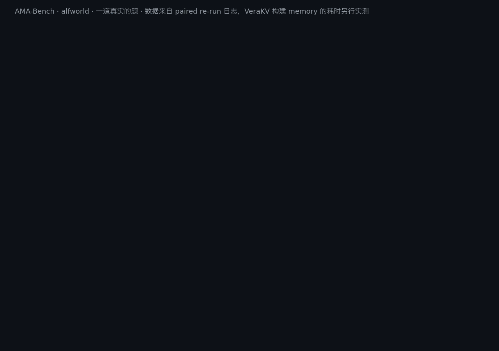
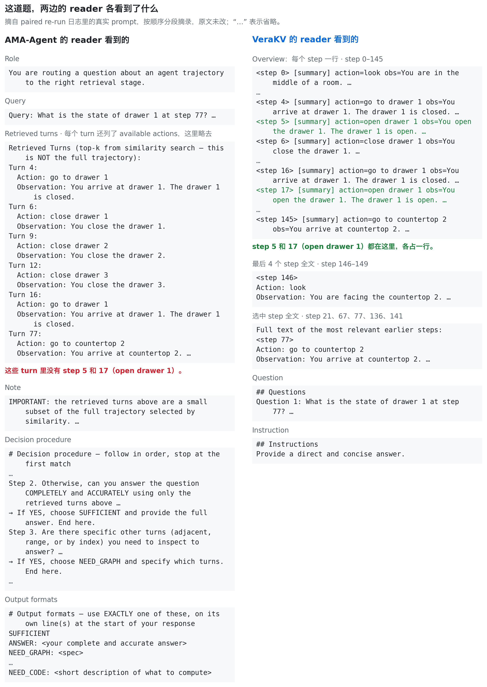
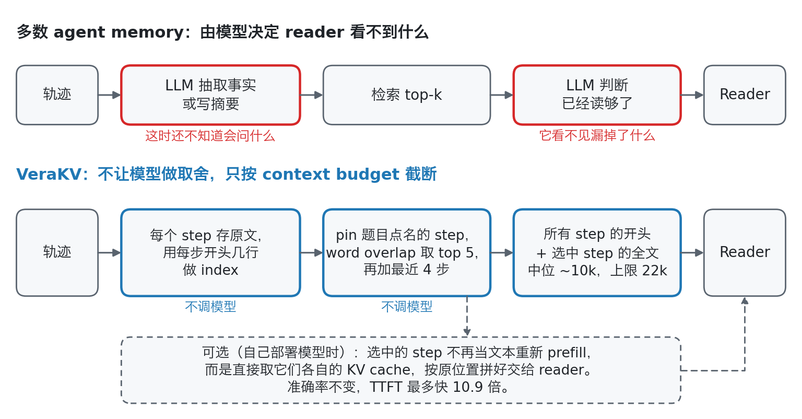
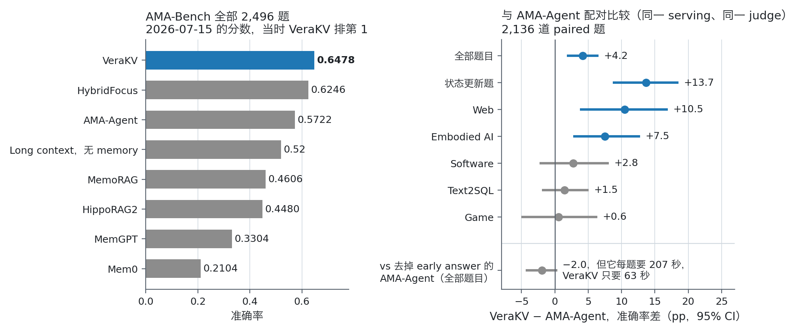
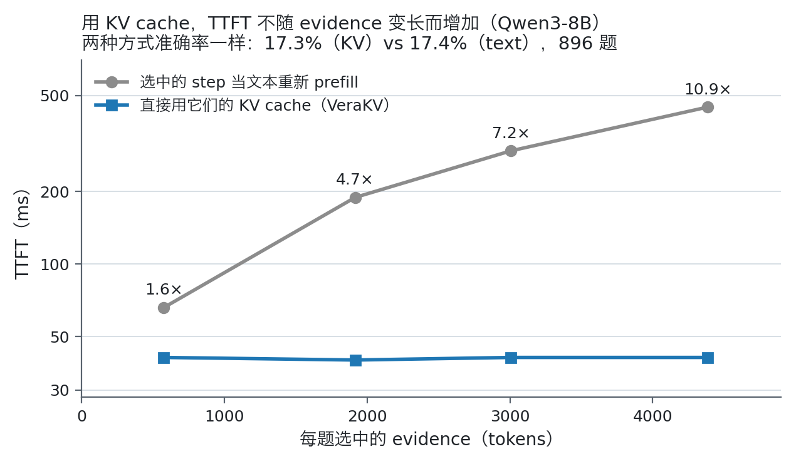

# VeraKV

**中文** | [English](README.en.md)



<sub>为这条 150 步的轨迹构建 memory，AMA-Agent 用了 76 秒、14 次 LLM 调用，VeraKV 用了 3.5 ms、不调模型：约快 20,000 倍（两边不在同一台机器上测）。这道题 VeraKV 调一次模型，82 秒答对。AMA-Agent 做完「够不够」检查后在 102 秒作答，答错；去掉它的 early answer，它要 3 次调用、311 秒，还是答错。AMA-Agent 的 76 秒来自运行日志（Qwen3-32B，vLLM，一台 8×A100）：14 次调用每次负责 ~8,192 字符，同时发出，每次 35–73 秒；每条轨迹只构建一次 memory。VeraKV 的 3.5 ms 是本仓库代码在笔记本 CPU（Apple M3 Pro）上跑 9 次的中位数（`figures/time_index_build.py`）。在 2,136 道 paired 题上，每题用时中位数：VeraKV 54 秒，AMA-Agent 71 秒，去掉 early answer 的 AMA-Agent 207 秒。这些 wall time 是在各自运行时的负载下测的，只看数量级。VeraKV 的 index 是每个 step 的开头几行，按 word overlap 和 step 编号选 step。这道题（AMA-Bench，alfworld 第 34 集）是从 VeraKV 对、AMA-Agent 错的 333 道题里挑的；反过来的有 252 道。除了那 3.5 ms，调用次数、用时和答案都取自 [paired re-run](docs/AMA_AGENT_PAIRED.md) 的日志；答案只显示前两句。下图：两边 reader 各自收到的 prompt 里有什么，按段摘自同一份日志。由 `figures/make_demo.py` 和 `figures/make_context.py` 根据 `figures/demo_case.json` 生成。</sub>

<picture>
  <source media="(prefers-color-scheme: dark)" srcset="assets/context-case-zh-dark.png">
  
</picture>

模型不知道自己没看到什么，所以 VeraKV 从不让模型决定该丢掉哪些内容。专为这个 benchmark 打造的 AMA-Agent，会问自己的模型「读够了没有」：84% 的题，模型看了检索到的 5 个 step 就说够了。VeraKV 比它高 4.2 个点，在状态变化类的题上高 13.7 个点。VeraKV 构建 memory 时一次模型都不调：对比去掉 early answer 的 AMA-Agent，准确率只差 2 个点左右，每题用时是它的三分之一。如果模型是自己部署的，选中的 step 还可以直接以它们自己的 KV cache 交给模型，准确率不变，TTFT 最多快 10.9 倍。

<picture>
  <source media="(prefers-color-scheme: dark)" srcset="assets/how-it-works-zh-dark.png">
  
</picture>

<picture>
  <source media="(prefers-color-scheme: dark)" srcset="assets/results-zh-dark.png">
  
</picture>

`0.6478`：AMA-Bench 得分，提交时（2026-07-15）leaderboard 第 1 · `+4.2`：同一 serving、同一 judge 下对 AMA-Agent · `10.9×`：用 KV cache 后 TTFT 的加速 · `76 s vs 3.5 ms`：为一条 150 步的轨迹构建 memory（AMA-Agent 14 次 LLM 调用，VeraKV 不调模型）

[论文（PDF）](paper/kvmemory.pdf) · [复现](#复现) · [与 AMA-Agent 对比的细节](docs/AMA_AGENT_PAIRED.md)<br>Agent memory 系列：[VeraKV](https://github.com/oklen/VeraKV)：该把什么交给模型 · [Compute Globally, Materialize Locally](https://github.com/oklen/Compute-Globally-Materialize-Locally)：evict 之后什么还在 · [TracePack](https://github.com/oklen/TracePack)：compaction 之后什么还在

**它是什么：** 给长时间运行的 agent 用的 memory 层。它保存原始轨迹，构建和查询 memory 都不调模型。每来一道题，它先 pin 住题目里点名的 step，其余 step 按 word overlap 排序，再加上最后几步。reader（根据 memory 作答的模型）拿到的是每个 step 的简短开头，加上选中 step 的**原文**：中位数约 10k token，上限 22k。选中的 step 可以作为文本交出去，也可以作为它们自己的 KV cache、放在原位置上交出去。

论文 [`paper/kvmemory.pdf`](paper/kvmemory.pdf)（*When Does KV Reuse Work for Agent Memory? A Controlled Study of Payload Fidelity, Store Conditioning, and Cache Harvesting — with a Reproducible State-of-the-Art System*，源文件 [`paper/kvmemory.tex`](paper/kvmemory.tex)）里每个数字背后的代码、配置、prompt、原始预测和 judge 输出都在这个仓库里。

## 我们学到了什么

- **更聪明的选 step 方法帮助不大。** 免费的 word overlap，加上题目点名的 step 编号，就够了。让 LLM 来选 step 没有带来提升，修好它那个坏掉的调用之后也一样（+0.2 [−1.5, +2.1] 和 +1.4 [−0.2, +3.2]；[详情](docs/MODEL_PICK_FIX.md)）。
- **reader 拿到多少内容，影响很大。** routing 固定时，把拼出的 context 从 6k 加到 22k token，准确率从 0.550 升到 0.644（在一半题目上测）。如果改成直接把原始轨迹最近的 22k token 交给 reader，会掉 8.4 个点。
- **AMA-Agent 输在答得太早。** 84% 的题，它在第一次「够不够」检查后就作答。去掉这个 early answer，它反超 VeraKV 约 2 个点，但每题用时是三倍。
- **KV cache 在 context window 内是精确的，换来的是延迟，不是准确率。** 取出选中 step 的 KV 拼起来，结果和完整 prefill 一致，得分也和把它们当文本重新读一样（17.3% vs 17.4%）。超出 window 时，各事件独立编码会掉 13.2 个点。

## 结果

| AMA-Bench 官方 harness，全部 2,496 题 | 准确率 |
|---|---|
| **VeraKV**：经公开 leaderboard 核验，2026-07-15 时排第 1 | **0.6478** |
| HybridFocus（leaderboard 条目） | 0.6246 |
| VeraKV，只用 memory 部分（harness 默认的 reader） | 0.5954 |
| AMA-Agent（专为这个 benchmark 打造） | 0.5722 |
| Long-context Qwen3-32B，不用 memory | 0.52 |
| MemoRAG | 0.4606 |
| HippoRAG2 | 0.4480 |
| MemGPT | 0.3304 |
| Mem0 | 0.2104 |

VeraKV 那几行是我们自己跑的；其他行是已发表的或 leaderboard 上的分数。

- **6 个 domain 赢了 5 个**，对比的是专为这个 benchmark 打造的 AMA-Agent 公布的分数。
- **光是 memory 部分就超过了 AMA-Agent 公布的分数：** 用 harness 自带的默认 reader、reader 一侧不做任何改动，0.5954 vs 0.5722。
- **在同一 serving、同一 judge 下和 AMA-Agent 正面对比。** 在 2,136 道 paired 题上，VeraKV 比原版 AMA-Agent 高 4.2 个点 [+1.8, +6.6]，state-update 题高 13.7 [+8.7, +18.6]。AMA-Agent 主要输在第一次「够不够」检查停得太早。去掉这个 early answer，它反超约 2 个点（相对这个配置 −2.0 [−4.4, +0.4]，相对 VeraKV 发布的、完全不调模型的配置 −2.3 [−4.6, −0.1]），但每题用时约 3 倍，生成的 token 约 7 倍。[详情](docs/AMA_AGENT_PAIRED.md)。
- **在 LOCOMO 上超过专门的对话 memory 系统：** 按 LOCOMO 公开的 gpt-4o-mini 协议，J = 0.704，Mem0 是 0.671，Zep 是 0.660。
- **TTFT 最多快 10.9 倍。** 直接取选中片段的 KV cache，而不是当文本重新读，TTFT 稳定在约 40 ms。evidence 增长到 4k token 的过程中，加速从 1.6 倍升到 10.9 倍，32k 时是 32 倍。生成的 first token 和完整 prefill 的 oracle 完全相同。

<picture>
  <source media="(prefers-color-scheme: dark)" srcset="assets/ttft-zh-dark.png">
  
</picture>

后来有一个 leaderboard 条目（0.6975，日期 2026-09-09）超过了 VeraKV，VeraKV 现在排第 2。在 gpt-4o-mini judge 下，直接把 LOCOMO 的完整历史放进 prompt 能得 0.756。这些以及其他协议上的 caveat 见论文和[测量上的说明](#测量上的说明)。

## 细节发现

- **在 agent 轨迹上测 payload fidelity。** 大多数 memory 系统都保存了原始历史，区别在于交给 reader 的是什么（Mem0 的 search 返回它抽取的事实；AMA-Agent 发布的代码把按 embedding 相似度取回的 top-5 原始 turn 和一段 LLM 写的 state summary 一起交出去，不过 84% 的题它更早就只凭那几个 turn 作答了；见 [paired re-run](docs/AMA_AGENT_PAIRED.md)）。在引用的 evidence、reader 和 judge 都相同时，把原文 step 换成简短的 LLM summary 或抽取的事实，会掉 8–10 个点（exact-recall 题掉 14）。这些 payload 也短得多，所以这里测的是它们漏掉了什么，而不是改写本身。在部署的 pipeline 里，确定性地换成和 query 相关的*原始行*掉 2.6 个点，换成 summary 和事实分别掉 5.1 和 5.9。AMA-Bench 自己的 needle 对照也给这个选择标了价：把含答案的 turn 换成 MemoryBank 构建的 memory，BabyAI 准确率从 0.46 降到 0.27（相对下降 41%）。
- **reader 是一个可以单独调的维度。** 同一批次的 memory × reader factorial 实验：不论哪种 reader，routing 都加 3.1–3.5 个点；不论哪种 routing，一句结构化作答 instruction 都加 5.1–5.5。这句 instruction 可以放在 memory 的返回值里一起交出去；做成 rotated skill-KV block，效果和文本 instruction 打平。
- **在 context window 内，KV gather 是精确的，省的是开销，并不会更准。** 在原位置取出选中片段的 KV cache，复现了「完整 prefill 再加 mask」的 oracle，准确率和把同样片段当文本重新 prefill 等价（17.3% vs 17.4%，896 题）；TTFT 不再随 evidence 长度增长。
- **超出 window 时的情况。** 各事件独立编码的 event store 在官方 harness 上崩掉（paired −13.2 个点，n=2431）；anchored store 再加两条新鲜的 tail 事件能找回 72%。两条有适用范围的规律：evidence 只有在联合编码时才转化成准确率；写入时的 conditioning 必须和交出去的内容在内容和位置上都对得上。六种在新 budget 内挑选的 selector（包括一种 KEEP 风格的）都没超过 recency，要么打平，要么落后。harvest agent 自己 rollout 时的 cache，可以在效果持平的情况下省掉约 5 倍的 store 写入开销（8B/32B、Qwen/Llama、AMA-Bench/LOCOMO）。一种混合部署策略在完整官方 harness 上和 routed-text carrier baseline 打平（.397 vs .397）。
- **系统本身。** 只用 memory 层（harness 默认的 reader）得 0.5954，专为这个 benchmark 打造的 AMA-Agent 公布的是 0.5722；加上公开说明的结构化作答 instruction，达到经核验的 0.6478。唯一没领先的 domain 是 SOFTWARE，差距不在检索或推理：剩下的主要是 temporal-scan 题（「哪一步第一次 / 最后一次……」），所有配置在这类题上都低，而且很多 gold 和轨迹对不上。

## 目录结构

```
paper/      kvmemory.tex + .bib + 样式文件 + 编译好的 PDF（30 页；tectonic 或 pdflatex）
kvmemory/   memory 包（core、components、routers、带 KV sub-selection 的 HF backend），以及每个实验一个
            模块，都能用 `python -m kvmemory.<name>` 运行（用法见各自的 docstring）
ama/        AMA-Bench 集成：harness/（2 个打过 patch 的文件）、configs/、agentic_reader.py（reader 模式
            ablation）、作答 instruction、maxutil_run.sh（vLLM 启动 + 分片 + 合并）、
            br_judge.py / bg_judge.py（用官方 judge 给 KV-bridge 的答案打分）、
            paired/（和 AMA-Agent 的 paired re-run；运行方法见 paired/README.md）
docs/       AMA_AGENT_PAIRED.md：和 AMA-Agent 的 paired re-run；MODEL_PICK_FIX.md：修好 model-pick 调用后的重跑
analysis/   把运行输出变成论文数字的脚本（见下表）
results/    逐题原始预测 + judge 分数（mu_merged_<TAG>.json，运行清单 mu_<TAG>_done）、
            results/oow/（KV serving 和 out-of-window 运行）、results/probes/（合成 probe）、
            results/ama_paired/（和 AMA-Agent 的 paired re-run）、results/modelpick_fix/（model-pick 修好后的
            重跑）、以及较小的输出；索引在 results/MANIFEST.md
scripts/    run_ama.sh：在一台 8×A100 上端到端跑官方 harness
figures/    make_figures.py：根据上面这些文件画 assets/ 里的 README 图（浅色/深色，英文/中文各一套）；
            make_demo.py 和 make_context.py：单题 demo 动图和「两边 reader 各看到什么」的图，数据来自
            demo_case.json（由 build_demo_case.py 生成）；time_index_build.py：测 VeraKV 为一集轨迹构建 memory 的耗时
submissions/ leaderboard 提交文件
data/       放 benchmark 数据的位置（不随仓库发布；见 data/README.md）
```

## 环境

用到了两套环境（具体版本见 [ENVIRONMENT.md](ENVIRONMENT.md)）：

- **AMA-Bench 官方 harness**（文本 pipeline，所有 leaderboard 口径的数字）：vLLM serve Qwen3-32B，同时当 reader 和 judge。
- **KV 实验**（`kvmemory/kv_*.py`）：HuggingFace transformers，每张 GPU 一份模型；Qwen3-8B、Qwen3-32B（用 `SPRAG_DEVICE_MAP=auto` 切分）、Llama-3.1-8B-Instruct。

各模块用到的环境变量：`SPRAG_MODEL_PATH`（本地模型目录，必填）、`SPRAG_EMBED_PATH`（Qwen3-Embedding-0.6B，embedding / hybrid router 用）、`SPRAG_ATTN_IMPL=sdpa`（store 实验的 block-diagonal mask 需要；attention probe 用 `eager`）、`SPRAG_ROPE_FACTOR=4.0` + `SPRAG_MAX_CTX=131072`（out-of-window 运行用 YaRN）。输出默认写到 `./out/`。

## 复现

**官方 harness 的运行（AMA-Bench，Qwen3-32B 当 reader 和 judge）。** 需要：一台 8×A100-80GB、[AMA-Bench](https://github.com/AMA-Bench/AMA-Bench)、vLLM、Qwen3-32B 权重。

```bash
git clone https://github.com/AMA-Bench/AMA-Bench
cp ama/harness/method_kvmemory.py  AMA-Bench/src/method/kvmemory.py      # 并在 src/method_register.py 里注册 "kvmemory"
cp ama/harness/memory_interface.py AMA-Bench/src/memory_interface.py     # 由环境变量控制的作答 instruction 和 reader hook
export AMA_BENCH=$PWD/AMA-Bench MODEL=/path/to/Qwen3-32B VENV=/path/to/vllm_env
bash scripts/run_ama.sh cfg_kvmem_causal.json MYTAG structured   # lexical + pin 的 memory，structured reader -> results/mu_merged_MYTAG.json
bash scripts/run_ama.sh cfg_kvmem_causal.json MYTAG_DEF plain     # 默认 reader（只用 memory）那一格
python analysis/cluster_ci.py                                     # 题目级和按 episode 聚类的 CI
```

`ama/maxutil_run.sh` 里写明了 reader 模式开关（`AMA_AGENTIC_READER`、`AMA_AGENTIC_MODE`）和打乱 pin 的 ablation（`SPRAG_PIN_SHUFFLE`）。提交的 0.6478 用的是 `cfg_flagship.json`（lexical + model-pick fusion + pin）；论文附录「The deployed router」显示这种 fusion 不影响分数，发布的默认配置是 `cfg_kvmem_causal.json`（lexical + step-pin）。在官方 harness 里，model-pick 调用跑在 Qwen3 的 thinking 模式下，只返回推理的开头；`cfg_flagship_nothink.json`（`"pick_thinking": false`）修好了这个调用，修好后的信号同样不影响分数（[docs/MODEL_PICK_FIX.md](docs/MODEL_PICK_FIX.md)）。

**KV 和 out-of-window 实验（HF transformers）。** AMA-Bench 测试文件放到 `data/ama_test.jsonl`（见 [data/README.md](data/README.md)）。每个模块的 docstring 里都写了运行命令，例如：

```bash
SPRAG_MODEL_PATH=/path/to/Qwen3-8B SPRAG_ATTN_IMPL=sdpa PYTHONPATH=. CUDA_VISIBLE_DEVICES=0 \
    python -m kvmemory.kv_globhot --shard 0 --queue_dir ./out/gh_q
```

机制子集的运行用 103 集 window 内的轨迹（≤24k token，按 domain 轮流抽取；n=824 题）和一个 8 路 work queue（`--queue_dir`，每张 GPU 一个进程）。官方 harness 的 bridge 先用 `kvmemory.kv_ama_bridge` 生成答案（Qwen3-32B，YaRN 4×），再用 AMA-Bench 自己的 judge 打分：`ama/br_judge.py`（tx / iso / b_hot）或 `ama/bg_judge.py`（deployment map）。

**用发布的输出算 paired 统计。**

```bash
python analysis/oow_paired.py results/oow/official_k12.jsonl.gz iso-tx b_hot-tx     # 表 "oow"，K=12
python analysis/oow_paired.py results/oow/gh.jsonl.gz glob_hotR-bh glob_R-glob     # harvest 那一格
python analysis/oow_paired.py results/oow/rv.jsonl.gz --arms                        # 列出所有 arm
```

`oow_paired.py` 能逐位复现准确率、discordant 对数和 exact McNemar p 值；它按 episode 聚类的 bootstrap（10,000 次，seed 0）和论文里的 CI 可能在最后一位上有出入。

## 实验 → 脚本（本次发布新增的结果）

| 论文位置 | 内容 | 脚本 | 输出 / 分析 |
|---|---|---|---|
| §3.4, Tab. "family" | 附录换成原始行 / 事实；完整轨迹按 recency 截断 | `ama/agentic_reader.py`（`extlines`、`facts`）、`ama/configs/cfg_full22.json` | `results/mu_merged_{EXTLW,FACTSW,FULLTR}.json` |
| §3.4, Fig. "payload" | oracle evidence 下的 payload ablation（verbatim / summary / facts，910 题）+ Llama-3.1-8B 重新 judge | `kvmemory/kv_payload.py`（vLLM client）、`kvmemory/kv_payload_hf.py`、`kvmemory/cross_judge.py` | — |
| App. D | memory 拼装 2×2（selection × gist overview），按 domain 拆分 | `ama/configs/cfg_arm_{recent,gist,retrieval}.json`、`cfg_kvmem_lex.json` | `results/mu_merged_ASM_*.json`、`analysis/assembly_2x2.py` |
| §3.1, App. E | SOFTWARE temporal-scan 题：所有配置都低，gold 有噪声（8B 和 32B reader） | `kvmemory/sw_mechanism.py` | `results/sw_mechanism/` |
| App. F | 部署 router 的审计：同批复现，lexical+pin 0.6466 vs model-pick hybrid+pin 0.6538，paired −0.8 个点 [−2.3, +0.8]；后来在升级后的 serving 栈上又跑了一次 model-pick，0.6410（未配对） | `ama/configs/cfg_kvmem_causal.json`、`cfg_flagship.json` | `results/mu_merged_RESTRLEXF.json`（lexical+pin）、`mu_merged_RESTRF2.json`（model-pick+pin，同批）、`mu_merged_RESTRF4.json`（model-pick+pin，后来那次）；flagship 的几次复现 `RESTRF`、`RESTRF2`、`RESTRF3` |
| App. G | 删掉 step 编号 / 只 pin 时的稳健性（+ Llama-3.1-8B 重新 judge） | `kvmemory/kv_stepablate.py`、`kvmemory/cross_judge.py` | — |
| §3.5, App. H | mask-oracle 检验（合成），0.7 vs 13.5 的 logit gap，TTFT 随 evidence 长度的变化 | `kvmemory/kv_select_smoke.py` | — |
| §3.5, App. H | 序列级 faithfulness、logit-KL、eager/SDPA、YaRN 4× | `kvmemory/kv_faithful.py` | — |
| §3.5, App. H | KV vs text 端到端持平：144 题和 896 题（17.3% vs 17.4%） | `kvmemory/kv_equiv.py` | `results/kv_equiv_144/`、`results/kv_equiv_896/` |
| §3.5 | 扰动没被选中的上游（gather 的 KV 变了 111/168，text 0） | `kvmemory/kv_sidechannel.py` | `results/kv_sidechannel/` |
| §3.7 | 存储开销，以及选中 token 到 64k 时的 TTFT；一次运行省下的 prefill | `kvmemory/kv_efficiency.py`、`kvmemory/bench_kv.py` | — |
| §3.7 | 常驻完整轨迹的 prefix-cache baseline | `kvmemory/kv_pfx.py` | `results/kv_cost/pfx_8b.json`、`analysis/pfx_ttft.py` |
| §3.6 | 把作答规程做成 rotated skill-KV block | `kvmemory/kv_skill.py` | `results/oow/sk.jsonl.gz` |
| §3.6 | 按 query 路由的 skill 库（替换 vs 追加；text vs KV） | `kvmemory/kv_skillib.py` | `results/oow/sl.jsonl.gz` |
| §4, Tab. "oow" | 官方 harness：tx / iso / anchored+tail，K=12 和 K=5 | `kvmemory/kv_ama_bridge.py`、`ama/br_judge.py` | `results/oow/official_k{12,5}.jsonl.gz` |
| §4 | over-window 那一格（30–100k，YaRN），8B 和 32B | `kvmemory/kv_owfloor.py` | `results/oow/owf{8,32}.jsonl.gz` |
| §4 | 分阶段的 query 开销、写入开销 | `kvmemory/kv_ttft.py` | `results/kv_cost/ttft_{8b,32b}.jsonl`、`analysis/ttft_stages.py` |
| §4 | evidence matching（tx_plus）、conditioner 内容、完整阅读的上限、tail dial（8B、32B） | `kvmemory/kv_review.py` | `results/oow/rv{,32}.jsonl.gz` |
| §4 | 生成 digest 当 conditioner，以及其他 floor arm | `kvmemory/kv_floor.py` | `results/oow/fl.jsonl.gz` |
| §4 | harvest 2×2（gather 的行、开头行、新鲜 tail）；Llama-3.1-8B 复现 | `kvmemory/kv_globhot.py` | `results/oow/gh{,_llama}.jsonl.gz` |
| §4 | agent 风格的 cache header；32B 的 harvest vs store vs 完整阅读 | `kvmemory/kv_hxfer.py` | `results/oow/hx{,32}.jsonl.gz` |
| §4 | LOCOMO，把 session 当事件（8B、32B；harvest 和 skill arm） | `kvmemory/kv_locomo.py` | `results/oow/loc{8,32}.jsonl.gz` |
| §4 | 分布层面的剖析（first-token KL） | `kvmemory/kv_klprobe.py` | `results/oow/kl.jsonl.gz`、`analysis/kl_probe.py` |
| §4 | fallback 触发条件（mode gate、self-verification、attention landing、voting） | `kvmemory/kv_gate.py`、`kv_verify.py`、`kv_attn.py`、`kv_matrix.py` | `results/oow/mx.jsonl.gz`、`analysis/{vote_analysis,cascade_ceiling}.py` |
| §4 Reg. I | 每种 carrier 的 K=5 vs K=12；给两条路径加同样多的事件 | `kvmemory/kv_ama_bridge.py`、`kvmemory/kv_evext.py` | `results/oow/official_k*.jsonl.gz`、`results/oow/ev.jsonl.gz` |
| §4 Reg. II | note-transplant 测试（delimiter vs 随机 anchor 行） | `kvmemory/kv_notesel.py` | `results/oow/nt.jsonl.gz` |
| §4 Reg. II | 冻结的全局 conditioner / conditioner 的几何结构 | `kvmemory/kv_fixanchor.py`、`kvmemory/kv_distanchor.py` | `results/oow/{fx,dx}.jsonl.gz` |
| §4 Reg. II | EPIC 风格的边界重算；dependency-graph conditioner | `kvmemory/kv_epic.py`、`kvmemory/kv_depanchor.py` | `results/oow/{ep,da}.jsonl.gz` |
| §4 | 六种 fresh-budget selector（recency、graph、attention、query、random；KEEP 风格） | `kvmemory/kv_frontier.py`、`kvmemory/kv_keepsel.py` | `results/oow/{fr,kp}.jsonl.gz` |
| §4 | 官方 harness 上的 deployment map（gsk vs anchored store vs text） | `kvmemory/kv_ama_bridge.py --arms gsk,g_txt`、`ama/bg_judge.py` | `results/oow/official_deploymap.jsonl.gz` |
| §4 probe 1–3 | phantom conclusion、erasure 边界、sink vs dependency | `kvmemory/kv_phantom.py`（+ `kv_vartrack.py`） | `results/probes/phvt/`、`analysis/probes/phvt_analyze.py` |
| §4 probe 4 | 四 arm 分解；不完整的 routing | `kvmemory/kv_vardecomp.py`、`kv_predigest.py`、`kv_predigest_sweep.py` | `results/probes/{vd,pd,pds}/`、`analysis/probes/` |
| §4 probe 4 | 独立 decoy、menu readout、entropy | `kvmemory/kv_decoyctl.py`、`kv_decoyctl2.py`、`kv_sweepmenu.py` | `results/probes/{dc,d2,sm}/` |
| §4 probe 4 | computed verdict、predicate binding、写入时的 note | `kvmemory/kv_mater.py`、`kv_refcarrier.py`、`kv_noteknob2.py` | `results/probes/{mt,rc,nk2}/`、`analysis/probes/nk2_analyze.py` |
| §3.2 | LOCOMO，Qwen3-32B reader/judge；公开的 gpt-4o-mini 协议 | `kvmemory/locomo_eval.py`、`kvmemory/locomo_gpt4omini.py` | — |
| §3.3 | LongMemEval-S（128k YaRN 读全文 vs 28k routed） | `kvmemory/longmemeval_eval.py` | — |
| App. I | 用 Llama-3.1-70B 重新 judge 一整次官方运行 | `analysis/rejudge_llama70b.py`、`ama/configs/judge_llama70b.yaml` | `results/judge_llama70b/ama_rejudged.json` |
| 论文之外 | 和 AMA-Agent 的 paired re-run：原版（A1）、按 token 计的 context 上限（A2）、无 early answer（A3）；VeraKV V1 / V2（[说明](docs/AMA_AGENT_PAIRED.md)） | `ama/paired/run.py`、`make_tokcap.py`、`make_nofast.py` | `results/ama_paired/`、`ama/paired/analyze.py`、`a3_analyze.py` |
| 论文之外 | 修好 model-pick 调用后重跑：两种 reader 下的 V1 / V1f / V2，2,496 题（[说明](docs/MODEL_PICK_FIX.md)） | `ama/paired/run.py`（arm V1f）、`ama/configs/cfg_flagship_nothink.json` | `results/modelpick_fix/`、`ama/paired/modelpick_analyze.py` |

共享模块 `kv_scope`、`kv_replay`、`kv_write`、`kv_matrix`、`kv_ow`、`kv_floor`、`kv_globhot`、`kv_distanchor` 和 `kv_orphan` 提供 out-of-window 运行要 import 的 store 编码、拼装和 gather 原语；每个模块也能当作它最初对应的那个实验单独运行。四个合成 probe 是姊妹论文 [Compute Globally, Materialize Locally](https://github.com/oklen/Compute-Globally-Materialize-Locally) 的起点，扩展版本在那边。`gpt-4o-mini` 的运行需要一个 OpenAI 兼容的 endpoint（`LOCOMO_API_BASE_URL`、`LOCOMO_API_KEY`）；用本地 reader 跑 LOCOMO / LongMemEval 需要一个 vLLM 服务。

## 测量上的说明

- AMA-Bench 只公开了 test split；leaderboard 配置是在它上面开发的，所以论文把 0.6478 标为探索性的工程结果。out-of-window 的方案先在 103 集的机制子集上开发，然后在完整的官方测试集上只评了一次。
- 同一天复跑的噪声约 0.5 个点，跨天约 2 个点，SOFTWARE 的批次噪声 ±4；报告的每个 paired 差值都来自同一批次；唯一一处跨批次的读数（App. F：0.6466 vs 0.6410）已经注明。
- §4 serving 格子的协议（固定 K 检索、没有 overview、官方默认的作答 prompt）不是部署的 pipeline；它的 text arm（.397）是一个 routed-text carrier baseline，比主系统低约 25 个点。不要跨协议比较这两者（论文附录「Protocol ledger」）。
- KV gather 只在位置 window 内是精确的；所有主要准确率都来自文本 pipeline。关于 cache 路径的结论只针对 TTFT，不代表整道题答得更快。
- 表格和前两条要点里对 AMA-Agent 的比较，用的是它公布的分数。我们重跑发布版 AMA-Agent，在它覆盖的 5 个 domain 上比公布分数低 4.9 个点，SOFTWARE 上低 26 个点，原因没有找到。paired 比较里两个系统都用我们自己的重跑（[复现核对](docs/AMA_AGENT_PAIRED.md#reproduction-checks)）。
- 部署 router 里的 model-pick 调用（32 个输出 token）在官方 harness 里从没按设计工作过：harness 没关 Qwen3-32B 的 thinking 模式，我们两次重跑里每次调用都停在模型的推理中间。论文的 router 审计看到的正是这些被截断的调用，结论是这个信号不影响分数。修好调用后，在全部 2,496 题上同批重跑，能正常工作的信号同样不影响分数：默认 reader +0.2 [−1.5, +2.1]，structured reader +1.4 [−0.2, +3.2]（[详情](docs/MODEL_PICK_FIX.md)）。

## 许可

代码以 MIT 许可发布（见 `LICENSE`）。benchmark 和数据集保留各自的许可：数据文件不随仓库发布（见 `data/README.md`）；逐题结果文件里引用了 AMA-Bench 的题目和参考答案，只是为了让分数可以核查。

## 联系

Zefeng Cai，见论文首页。
